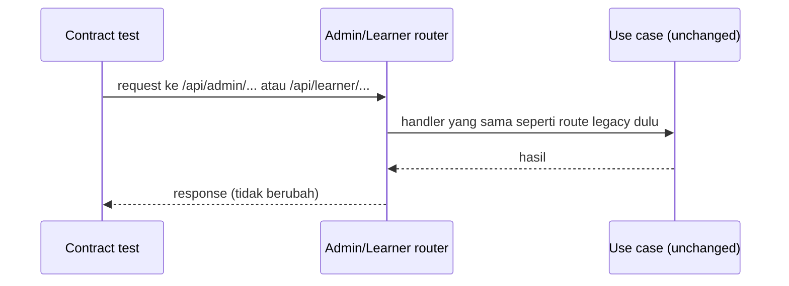

# Hapus Endpoint Deprecated (Legacy Compatibility) Design Doc

| | |
|---|---|
| **Status** | Implemented (menunggu review) |
| **Author(s)** | [perlu konfirmasi: nama & email author] |
| **Reviewer(s)** | [perlu konfirmasi: reviewer] |
| **Tanggal Dibuat** | 2026-10-10 |
| **Terakhir Diupdate** | 2026-10-10 |
| **Service Terkait** | `services/lms-system` |
| **Ticket / Issue** | [perlu konfirmasi: ticket/issue] |

## Ringkasan (TL;DR)

`lms-system` menyimpan 62 endpoint bertanda `deprecated=True` — seluruh surface tag `Legacy Compatibility` (`/api/courses/...`, `/api/quiz-sittings/...`, `/api/v1/servers`, dll). Setiap endpoint sudah punya pengganti di `/api/admin/*` atau `/api/learner/*` yang memakai handler dan dependency auth yang sama, dan dashboard sudah memakai path baru. Dokumen ini menetapkan penghapusan seluruh 62 endpoint, pembersihan registrasi di `main.py`, dan migrasi contract test yang masih menembus path legacy.

## Latar Belakang & Masalah

Saat canonical `/api/admin/*` dan `/api/learner/*` diperkenalkan, router lama dipertahankan sebagai transitional compatibility layer dan ditandai `deprecated=True`. Kondisi saat ini:

- 62 route legacy aktif dan terdaftar di `app/main.py`, tersebar di 10 file router: `quizzes.py` (20), `sections.py` (7), `courses.py` (6), `modules.py` (6), `enrollments.py` (6), `collect_tasks.py` (6), `servers.py` (5), `course_labs.py` (4), `admin_enrollments.py` (1), `learner_enrollments.py` (1).
- Tag `Legacy Compatibility` masih tampil di OpenAPI, sehingga permukaan API yang disajikan ke konsumen lebih besar dari kontrak yang didukung.
- Verifikasi menunjukkan **setiap** route legacy punya pengganti: 61 route merupakan stacked decorator di atas handler yang sama, dan `GET /api/files/{file_id}` di `collect_tasks.py` berpasangan dengan `/api/admin/files/{file_id}`. Auth dan business rule identik karena handler-nya sama — legacy bukan jalur fallback berperilaku beda, hanya alias path.
- `AGENTS.md` menyatakan router `sections.py` adalah transitional/compatibility code: penghapusannya mensyaratkan specification, migration plan, dan regression tests. Dokumen ini memenuhi specification dan migration plan tersebut.
- Sembilan file contract test masih menembus path legacy (`/api/v1/servers` 13 kali, `/api/courses/{COURSE}/lab/enroll` 11 kali, `/api/quiz-sittings`, sections/modules/quizzes), sehingga penghapusan route akan memecahkan test kecuali dimigrasi.

## Tujuan

- 62 route legacy hilang dari aplikasi (menghasilkan 404), dengan route `/api/admin/*` dan `/api/learner/*` tidak berubah.
- Tag `Legacy Compatibility` hilang dari `OPENAPI_TAGS` dan dari output OpenAPI.
- Setiap skenario yang saat ini hanya diuji lewat path legacy tetap tercakup: test duplikat dihapus, test yang menekan skenario unik dimigrasi ke path pengganti.
- Tidak ada decorator `@router.*` legacy, registrasi `app.include_router(<legacy>)`, atau import router legacy yang tersisa.
- Test suite hijau setelah perubahan, tanpa melemahkan cakupan regression pada course/module/chapter ordering, quiz evaluation, dan lab access.

## Non-Tujuan (Out of Scope)

- Tidak mengubah perjanjian kontrak `/api/admin/*` dan `/api/learner/*` (path, request, response, status code).
- Tidak menyediakan fase sunset `410 Gone`, feature flag, atau periode deprecation tambahan — route langsung dihapus (lihat Alternatif A).
- Tidak menyentuh domain, application, infrastructure, atau skema database: nol perubahan behavior dan nol migrasi data.
- Tidak merapikan helper bersama (`can_manage`, `use_cases`, `require_learner_enrollment` di `courses.py`) — helper ini masih dipakai handler admin/learner.
- Tidak menghapus endpoint legacy pada service lain di monorepo meskipun namanya mengandung "Legacy".
- Tidak menambah dokumentasi API baru atau klien baru.

## Proposal / Desain

### 1. Hapus decorator dan objek router legacy

Di 10 file router, hapus baris `@router.<method>(...)` legacy dan objek `router = APIRouter(..., tags=["Legacy Compatibility"])`. Handler-nya tidak dihapus karena route admin/learner memakai handler yang sama.

| File | Route legacy dihapus | Prefix legacy | Pengganti |
|---|---|---|---|
| `courses.py` | 6 | `/api/courses` | `/api/admin/courses`, `/api/learner/courses` |
| `modules.py` | 6 | `/api/courses/{course_slug}/modules` | `/api/admin/courses/{course_slug}/modules`, `/api/learner/courses/{course_slug}/modules` |
| `sections.py` | 7 | `/api/courses/{course_slug}/modules/{module_slug}/sections` | `/api/admin/...`, `/api/learner/...` (prefix sama + segmen admin/learner) |
| `quizzes.py` | 20 | `/api/courses/{course_slug}/...`, `/api/quiz-sittings/{sitting_id}/...` | `/api/admin/courses/...`, `/api/learner/quiz-sittings/...` |
| `enrollments.py` | 6 | `/api/courses/{course_slug}/enrollments` | `/api/admin/courses/{course_slug}/enrollments`, `/api/learner/courses/{course_slug}/enrollments` |
| `admin_enrollments.py` | 1 | `/api/enrollments` | `/api/admin/enrollments` |
| `learner_enrollments.py` | 1 | `/api/me/enrollments` | `/api/learner/enrollments` |
| `course_labs.py` | 4 | `/api/courses/{course_slug}/lab` | `/api/admin/courses/{course_slug}/lab`, `/api/learner/courses/{course_slug}/lab` |
| `servers.py` | 5 | `/api/v1/servers` | `/api/admin/servers` |
| `collect_tasks.py` | 6 | `/api/courses/.../collect-task`, `/api/files/{file_id}` | `/api/learner/courses/.../collect-task`, `/api/admin/files/{file_id}` |

Catatan route yang terpecah dua: `GET /api/courses` legacy melayani editor dan learner sekaligus (bercabang di `can_manage`), sehingga penggantinya dua route — `GET /api/admin/courses` dan `GET /api/learner/courses`. Hal yang sama berlaku untuk `GET /api/courses/{slug}`, `GET .../modules/{slug}`, `GET .../sections/{slug}`.

### 2. Bersihkan composition root

Di `app/main.py`:

- Hapus import alias `router as <name>_router` untuk `courses`, `course_labs`, `enrollments`, `learner_enrollments`, `admin_enrollments`, `modules`, `sections`, `servers`, `quizzes`, `collect_tasks`.
- Hapus 10 baris `app.include_router(<legacy>_router)`.
- Hapus entri `{"name": "Legacy Compatibility"}` dari `OPENAPI_TAGS`.

### 3. Migrasi contract test

Audit per file di `tests/contract/http/`: tidak ada skenario yang murni duplikat, sehingga seluruh test dialihkan (bukan dihapus) ke path pengganti dengan role token yang sesuai (admin/instructor untuk `/api/admin/*`, learner untuk `/api/learner/*`). Sebelas file contract test tersentuh.

Aturan pengalihan path yang dipakai (longest-prefix-first):

| Path legacy | Path pengganti |
|---|---|
| `/api/v1/servers` | `/api/admin/servers` |
| `/api/quiz-sittings/{id}/...` | `/api/learner/quiz-sittings/{id}/...` |
| `/api/me/enrollments` | `/api/learner/enrollments` |
| `/api/files/{file_id}` | `/api/learner/files/{file_id}` |
| `/api/courses`, `/api/courses/{slug}` (authoring) | `/api/admin/courses`, `/api/admin/courses/{slug}` |
| `/api/courses/{slug}` (read milik learner), `.../progress`, `.../sections/{s}/complete`, `.../quiz/sittings`, `.../collect-task`, `.../lab/my-lab`, `.../enrollments/me` | prefix `/api/learner/...` |
| `/api/courses/{slug}/enrollments...` (admin), `.../lab/enroll`, `.../lab/release/{u}`, `.../lab/accesses`, `.../modules/...` (authoring) | prefix `/api/admin/...` |

### 4. Titik verifikasi

- `pytest` penuh: 225 passed, 2 failed — keduanya sudah gagal di `HEAD` sebelum perubahan ini (`test_collect_task_file_upload_keeps_revision_files_private_and_downloadable` baris review instructor 403, dan `tests/integration/persistence/test_learning_progress.py::test_collect_task_file_links_round_trip_per_submission_history`); tidak diperbaiki di sini karena di luar scope.
- Pencarian `deprecated=True`, `Legacy Compatibility`, dan referensi router legacy di `app/` menghasilkan nol hasil.
- OpenAPI hasil `app.openapi()` tidak memuat path legacy; 62 path pengganti tetap ada.
- Latent bug yang tersingkap dan ikut diperbaiki: `get_learner_module` memanggil `ContentCrudUseCases.get_module()` tanpa argumen wajib `include_archived` (route learner belum pernah tersentuh test sebelum migrasi ini).

## Alternatif yang Dipertimbangkan

| Alternatif | Kelebihan | Kekurangan | Kenapa tidak dipilih |
|---|---|---|---|
| **A. Hapus langsung semua 62 route** (dipilih) | Kode legacy hilang seketika, tidak ada cleanup lanjutan; dashboard sudah di path baru; tidak ada biaya maintenance tambahan | Breaking change bagi konsumen di luar repo yang belum terverifikasi; tidak ada jaring pengaman | Tidak ada pemanggil legacy yang ditemukan di monorepo; seluruh route punya pengganti dengan handler identik, sehingga risiko migrasi konsumen rendah. Asumsi konsumen eksternal dicatat di Pertanyaan Terbuka |
| **B. Pertahankan route, ubah respons menjadi `410 Gone` selama satu rilis** | Memberi konsumen eksternal sinyal eksplisit dan waktu migrasi | Menambah kode temporary yang harus dihapus lagi di rilis berikutnya; tetap menyisakan 62 route di OpenAPI; tidak menghilangkan tag Legacy; memerlukan pekerjaan test dua kali | Biaya dan noise lebih besar dari risikonya karena tidak ada konsumen legacy yang teridentifikasi |
| **C. Biarkan `deprecated=True` tanpa menghapus** | Nol risiko dan nol pekerjaan sekarang | Tag `Legacy Compatibility` dan 62 route terus tampil di OpenAPI; dua kontrak untuk perilaku yang sama; rot membesar dan biaya penghapusan naik seiring waktu | Status quo adalah masalah yang ingin diselesaikan dokumen ini; `deprecated=True` sudah lama dipasang tanpa ada penghapusan |

## Dampak & Risiko

- **Backward compatibility**: breaking change untuk konsumen yang memanggil path legacy — permintaan ke 62 route tersebut akan menjadi 404. Konsumen yang terverifikasi di monorepo (dashboard) sudah memakai `/api/admin/*` dan `/api/learner/*`; backoffice tidak memanggil LMS. Sisa risiko: konsumen produksi di luar monorepo yang belum terverifikasi (lihat Pertanyaan Terbuka). Route pengganti tidak berubah, sehingga konsumen yang sudah migrasi tidak terdampak.
- **Migrasi data**: tidak ada. Tidak ada perubahan skema, kolom, atau data; tidak ada migration script yang perlu dijalankan atau di-rollback.
- **Performa**: netral hingga positif. Tidak ada perubahan query atau jalur runtime; yang berkurang hanya jumlah route yang didaftarkan saat startup dan ukuran OpenAPI. Penghapusan route juga menghindari dua kali pendaftaran handler yang sama di router berbeda.
- **Keamanan**: nol delta, dan sedikit positif. Route legacy dan penggantinya berbagi handler serta dependency auth yang sama (`require_content_editor`, `require_roles("admin")`, `get_current_user`), jadi tidak ada endpoint dengan otorisasi lebih lemah yang hilang atau tersisa. Permukaan API yang bisa dipindai berkurang 62 path, dan `deprecated=True` pada path lama yang berpotensi dipakai untuk bypass kebijakan baru ikut hilang.
- **Operasional**: tanpa koordinasi data; deployment mengikuti rilis biasa. Rollback = revert commit dan redeploy versi sebelumnya (tidak ada state yang perlu dipulihkan). Perlu urutan deploy: lms-system boleh dirilis lebih dulu karena dashboard sudah memakai path baru; tidak ada perubahan pada sisi dashboard yang diperlukan. Monitoring: pantau 404 pada path legacy setelah rilis sebagai sinyal adanya konsumen tak terduga.

## Rencana Implementasi (opsional)

1. **Fase 1 — Dokumen**: plan ini dan `docs/progress/remove-deprecated-endpoints.md` diinisialisasi dan saling tertaut sebelum kode ditulis.
2. **Fase 2 — Hapus route**: hapus 62 decorator legacy dan 10 objek `router` di 10 file router.
3. **Fase 3 — Bersihkan composition root**: hapus import, `app.include_router(...)`, dan entri tag `Legacy Compatibility` di `main.py`.
4. **Fase 4 — Migrasi test**: audit 11 file contract test; migrasi skenario unik ke path pengganti dengan role token yang sesuai.
5. **Fase 5 — Verifikasi**: jalankan test suite, pencarian sisa penanda legacy, dan cek daftar route aplikasi terhadap path legacy.
6. **Fase 6 — Perbaikan latent bug**: `get_learner_module` diberi `include_archived=True` agar route learner `GET /api/learner/courses/{slug}/modules/{module_slug}` berfungsi.

## Pertanyaan Terbuka

- Apakah ada konsumen produksi di luar monorepo (aplikasi mobile, integrasi pihak ketiga, script/klien eksternal) yang masih memanggil `/api/courses/...`, `/api/quiz-sittings/...`, `/api/v1/servers`, `/api/enrollments`, `/api/me/enrollments`, atau `/api/files/{file_id}`? `[perlu konfirmasi: belum terverifikasi dari repo]`. Jika ada, Alternatif B (410 Gone satu rilis) menjadi relevan.
- Siapa Author dan Reviewer dokumen ini, dan apakah ada ticket/issue yang menjadi induk pekerjaan ini? `[perlu konfirmasi]`.
- Apakah diperlukan pengumuman/sunset notice ke tim konsumen sebelum rilis, atau penghapusan dirilis begitu saja? `[perlu konfirmasi]`.
- Apakah ada deadline rilis yang mengharuskan fase penghapusan route dan migrasi test dipecah menjadi dua PR terpisah meskipun dokumen ini menetapkan satu perubahan? `[perlu konfirmasi]`.
- Asumsi yang dipakai tanpa verifikasi: route pengganti dianggap 100% setara secara behavior karena berbagi handler — belum diuji per-endpoint terhadap riwayat bug legacy. `[perlu konfirmasi]`.
- Alias websocket `/api/v1/servers/{server_id}/console` di `app/presentation/websocket/console.py` tetap ada: path ini tidak pernah ditandai `deprecated=True`, jadi di luar 62 endpoint yang jadi scope dokumen ini. Apakah ikut dihapus (dan menjadi `/api/admin/servers/{server_id}/console` saja) atau dipertahankan? `[perlu konfirmasi]`.

## Referensi

- `AGENTS.md` — aturan transitional router `sections.py`, testing requirements, dan Clean Architecture.
- `app/main.py` — registrasi router legacy dan `OPENAPI_TAGS`.
- `app/presentation/routers/{courses,modules,sections,quizzes,enrollments,admin_enrollments,learner_enrollments,course_labs,servers,collect_tasks}.py` — 62 route deprecated.
- `services/dashboard/features/modules/lms/**` — konsumen in-repo yang sudah memakai `/api/admin/*` dan `/api/learner/*`.
- `tests/contract/http/*` — contract test yang menembus path legacy (11 file dialihkan).
- `app/presentation/routers/modules.py` — perbaikan `get_learner_module` (`include_archived`).
